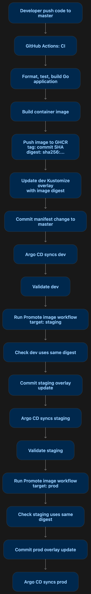

# Go Hello World

A minimal Go HTTP service with environment-aware demo endpoints and Kubernetes manifests.

## Architecture
The deployment architecture uses GitHub Actions to build and promote one immutable
container image through the `dev`, `staging`, and `prod` environments.


Argo CD continuously synchronizes the Kustomize overlays from GitHub into the
corresponding Kubernetes namespaces.


## Run locally

```sh
cd go-hello-world
go run .
```

Open <http://localhost:8080> to see `Hello, world!`. `APP_ENV` controls the environment in the two service responses; it defaults to `local`.

```sh
APP_ENV=dev go run .
```

Endpoints:

- `GET /service1` returns `hello world service1 from dev`
- `GET /service2` returns `hello world service2 from dev`
- `GET /healthz` returns `ok` for Kubernetes health probes

เปลี่ยน `APP_ENV` เป็น `staging` หรือ `prod` เพื่อดูการตอบกลับที่สอดคล้องกัน สร้างอิมเมจคอนเทนเนอร์เพียงหนึ่งรายการและเลื่อนขั้นไดเจสต์ของอิมเมจเดียวกันที่ไม่เปลี่ยนแปลงไปยังแต่ละสภาพแวดล้อม โดย Kustomize overlay แต่ละรายการจะกำหนดค่า `APP_ENV` ของตัวเอง

Change `APP_ENV` to `staging` or `prod` to see the corresponding response. Build one container image and promote the same immutable image digest through environments; each Kustomize overlay sets its own `APP_ENV`.

## GitOps deployment and image promotion

Argo CD มี Application หนึ่งรายการต่อสภาพแวดล้อม และเฝ้าดู `deploy/k8s/overlays/dev`, `deploy/k8s/overlays/staging` และ `deploy/k8s/overlays/prod` โดย CI จะทดสอบแอป สร้างและ push image หนึ่งรายการไปยัง GHCR จากนั้นอัปเดต Kustomize overlay ของ `dev` ให้ใช้ digest แบบไม่เปลี่ยนแปลง

Argo CD has one Application per environment and watches `deploy/k8s/overlays/dev`, `deploy/k8s/overlays/staging`, and `deploy/k8s/overlays/prod`. CI tests the app, builds and pushes one image to GHCR, then updates the `dev` Kustomize overlay to that image's immutable digest. The workflow run summary shows the digest.

หลังจากตรวจ image `dev` แล้ว ให้เรียกใช้เวิร์กโฟลว์ GitHub Actions **Promote image** โดยเลือกสภาพแวดล้อม `staging` และใช้ digest `sha256:...` เดียวกัน เมื่อตรวจสอบ `staging` แล้ว ให้เรียกใช้อีกครั้งโดยเลือกสภาพแวดล้อม `prod` และใช้ digest เดิม เวิร์กโฟลว์จะตรวจสอบว่าสภาพแวดล้อมก่อนหน้าใช้งาน digest นี้อยู่แล้ว อัปเดตเฉพาะ Kustomize overlay ที่ขอ และ commit การเปลี่ยนแปลงเพื่อให้ Argo CD ซิงค์ การดำเนินการนี้ช่วยให้อาร์ติแฟกต์ที่เลื่อนขั้นเหมือนกันในทุกสภาพแวดล้อม และทำให้ติดตามการเปลี่ยนแปลงแต่ละครั้งได้ใน Git

After validating the image in dev, run the **Promote image** GitHub Actions workflow with environment `staging` and the same `sha256:...` digest. After validating staging, run it again with environment `prod` and that same digest. The workflow checks that the preceding environment already uses the digest, updates only the requested Kustomize overlay, and commits the change for Argo CD to sync. This keeps the promoted artifact identical across environments and makes each change traceable in Git.

ใช้ manifests namespace แยกกันสำหรับ `dev`, `staging` และ `prod` ให้แทนที่โฮสต์ Ingress ตัวอย่างด้วยชื่อ DNS จริง และต้องติดตั้ง NGINX Ingress Controller ในคลัสเตอร์ไว้แล้ว

The manifests use separate `dev`, `staging`, and `prod` namespaces. Replace the example Ingress hosts with real DNS names. An NGINX Ingress Controller must already be installed in the cluster.

สำหรับการ deploy ด้วยตนเองในเครื่อง ให้ใช้ `kubectl apply -k deploy/k8s/overlays/dev` (หรือ `staging` / `prod`) เพื่อใช้โอเวอร์เลย์ของแต่ละสภาพแวดล้อม

For a local manual deployment, apply each environment overlay with `kubectl apply -k deploy/k8s/overlays/dev` (or `staging` / `prod`).

ใช้การกำหนดค่าสภาพแวดล้อมที่แตกต่างกัน (รวมถึงซีเคร็ต หากมีการเพิ่ม) สำหรับแต่ละ namespace อย่าอัปเดตแท็กอิมเมจด้วยตนเอง ให้ Promote image ผ่านเวิร์กโฟลว์ GitHub Actions เพื่อให้ทุกสภาพแวดล้อมใช้อิมเมจที่สร้างขึ้นเดียวกัน

Use distinct environment config (and secrets, if added) per namespace. Do not update image tags by hand; promote the digest through the GitHub Actions workflow so every environment runs the same built image.
